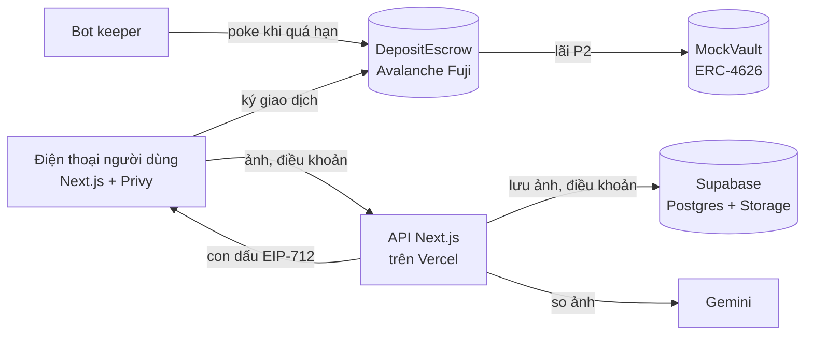

# Két Cọc Trọ

Giữ tiền cọc thuê trọ trong smart contract trên Avalanche, có AI đối chiếu ảnh nhận phòng và trả phòng. Không ai, kể cả nhóm phát triển, rút được tiền cọc ra ngoài người thuê và chủ trọ.

Dự án dự thi Team1 Vietnam UniHack 2026.

## Vấn đề

Ở Việt Nam, tiền cọc thuê trọ thường do chủ trọ giữ. Khi trả phòng, hai bên dễ bất đồng về hư hỏng, mức trừ và thời điểm hoàn cọc. Số tiền chỉ vài triệu đồng nên hiếm ai kiện ra tòa, và pháp luật không quy định thời hạn hoàn cọc bắt buộc.

## Cách hoạt động

1. Chủ trọ đăng phòng kèm điều khoản: tiền cọc, phí giữ chỗ, ngày dọn vào và hết hạn, danh sách vị trí cần chụp, bảng giá sửa chữa. Tất cả được khóa bằng một hash trên chuỗi.
2. Người thuê gửi cọc bằng stablecoin, chỉ ký 1 lần (ERC-2612 permit). Tiền nằm trong contract.
3. Ngày dọn vào, người thuê chụp ảnh theo danh sách vị trí bằng camera trong app. Hash của bộ ảnh được ghi lên chuỗi.
4. Khi trả phòng, người thuê chụp lại đúng các vị trí đó. AI so ảnh trước và sau, tách hư hỏng mới khỏi hao mòn, tính mức trừ theo bảng giá và ký một con dấu (EIP-712).
5. Chủ trọ đề xuất mức trừ. Người thuê đồng ý hoặc im lặng tới hạn thì contract chia tiền ngay. Người thuê kháng nghị thì bồi thẩm chọn một trong hai con số; AI chỉ là một phiếu.
6. Mỗi bước có hạn chót. Bên nào im lặng tới hạn thì bên đó chịu, và ai cũng gọi được hàm xử lý quá hạn, nên tiền không bao giờ kẹt.

AI chỉ đề xuất và ký con dấu. AI không có ví và không chuyển được tiền; tiền chỉ rời két theo quy tắc trong contract.

## Vì sao dùng Avalanche

- C-Chain tương thích EVM: Solidity, OpenZeppelin, MetaMask dùng như bình thường.
- Giao dịch chốt trong khoảng 1 đến 2 giây: người thuê đứng trong phòng thấy cọc đã khóa ngay.
- Phí thấp, phù hợp khoản cọc vài triệu đồng.
- Hướng mở rộng: một L1 riêng dùng stablecoin làm phí gas, để người thuê không cần biết tới AVAX.

## Kiến trúc



Tiền chỉ đi giữa ví người dùng, contract và vault. API và AI không giữ tiền, không có quyền chuyển tiền.

| Thành phần | Công nghệ | Việc |
| --- | --- | --- |
| `contracts/` | Solidity 0.8.24, Foundry, OpenZeppelin v5 | `DepositEscrow` giữ cọc, máy trạng thái 11 trạng thái, chia tiền, bồi thẩm, kiểm tra con dấu AI. `MockUSDC` là stablecoin test, `MockVault` là vault ERC-4626 sinh lãi giả. 88 test (có fuzz và test bất biến) |
| `web/` | Next.js, Privy, wagmi, viem | Giao diện, đăng nhập Google tạo ví, camera, API |
| `web/app/api/v1/` | Next.js Route Handlers | Lưu ảnh và điều khoản ngoài chuỗi, tính hash, gọi AI, ký con dấu, bot keeper |
| `web/lib/ai/` | Gemini 3.1 Flash-Lite (so ảnh), OpenAI (giải thích tiếng Việt, tham khảo) | So ảnh, trả kết luận có cấu trúc |

Đặc tả đầy đủ trong [`docs/`](docs/): [contract](docs/contract-spec.md), [API](docs/api-contract.md), [dữ liệu](docs/data-contract.md), [luồng người dùng](docs/user-flow.md).

## Contract đã deploy (Avalanche Fuji, chain ID 43113)

<!-- deployments:start (bảng này do scripts/update-deployments.mjs tự ghi sau mỗi lần deploy) -->
| Contract | Địa chỉ |
| --- | --- |
| `DepositEscrow` | [0xcdd2f2c92894dcb0195d0132f3e3a401116c1ded](https://testnet.snowtrace.io/address/0xcdd2f2c92894dcb0195d0132f3e3a401116c1ded) |
| `MockUSDC` | [0x33c45a61afea47d612c65f1188d1962f7a1bd172](https://testnet.snowtrace.io/address/0x33c45a61afea47d612c65f1188d1962f7a1bd172) |
| `MockVault` | [0x6fea9f31393720f63baa5687b1471a24bbe104b6](https://testnet.snowtrace.io/address/0x6fea9f31393720f63baa5687b1471a24bbe104b6) |
<!-- deployments:end -->

App: [unihack-tamk.vercel.app](https://unihack-tamk.vercel.app). Mã nguồn contract đã verify trên Snowtrace.

## Chạy thử

Hướng dẫn cài đặt chi tiết cho người trong nhóm: [`DEVELOPER.md`](DEVELOPER.md).

```bash
cd web
cp .env.example .env.local   # bỏ trống DATABASE_URL thì server tự dùng database trong máy (PGlite)
npm install
npm run dev
```

Test contract: `cd contracts && npm install && npm run setup && forge test`.

## Giới hạn đã biết

- Danh sách bồi thẩm do nhóm thêm và bồi thẩm chưa có thưởng, nên nhóm vẫn ảnh hưởng được kết quả tranh chấp (nhưng không lấy được tiền). Hướng sau: bồi thẩm đặt cọc, bỏ phiếu đúng bên thắng thì nhận một phần phí sàn.
- Độ chính xác AI chưa được đo trên ảnh phòng trọ thật; AI chỉ đề xuất và là một phiếu, người thuê luôn kháng nghị được.
- Ảnh vẫn có thể bị dàn dựng; camera trong app, thời gian và hash trên chuỗi làm việc giả mạo khó hơn chứ không loại bỏ hẳn.
- Vault ERC-4626 đang rỗng có thể bị "tặng" tiền trước để người gửi đầu chịu lỗ. Hiện chặn bằng khoản gửi mồi lúc deploy; bản sau nên thêm kiểm tra số cổ phần tối thiểu ngay trong contract.
- MVP chỉ dùng token test trên Fuji. Luật chia tiền cần luật sư xem trước khi dùng tiền thật.

## Nhóm

| Vai | Thành viên |
| --- | --- |
| Contract + Backend | Lê Quang Khải |
| Frontend | _điền tên_ |
| AI | Lê Đăng Khoa |
