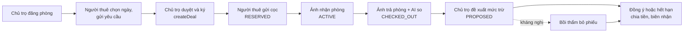
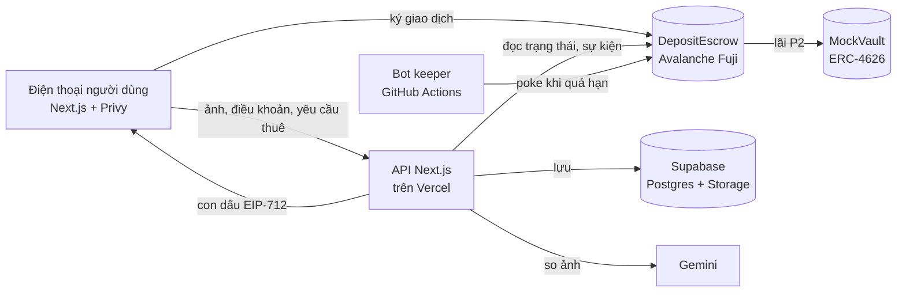

# Két Cọc Trọ

Giữ tiền cọc thuê trọ trong smart contract trên Avalanche, có AI đối chiếu ảnh nhận phòng và trả phòng. Không ai, kể cả nhóm phát triển, rút được tiền cọc ra ngoài người thuê và chủ trọ.

Dự án dự thi Team1 Vietnam UniHack 2026. App: [unihack-tamk.vercel.app](https://unihack-tamk.vercel.app) (Avalanche Fuji, chỉ dùng tiền thử).

## Đọc nhanh theo tiêu chí chấm

| Tiêu chí | Đã làm | Kiểm chứng ở đâu |
| --- | --- | --- |
| Kỹ thuật | Contract 11 trạng thái, 8 hạn chót, chia tiền một chỗ duy nhất (`_payout`); con dấu AI EIP-712 gắn với hash ảnh trên chuỗi; test đơn vị, fuzz và bất biến; CI chặn merge khi đỏ | [`contracts/src/DepositEscrow.sol`](contracts/src/DepositEscrow.sol), [`contracts/test/`](contracts/test/), [`.github/workflows/ci.yml`](.github/workflows/ci.yml) |
| Tích hợp Avalanche | Contract chạy trên Fuji C-Chain, mã nguồn đã verify; stablecoin có permit để gửi cọc trong 1 giao dịch; định hướng L1 riêng dùng stablecoin làm phí gas | [Contract đã deploy](#contract-đã-deploy-avalanche-fuji-chain-id-43113), [Vì sao dùng Avalanche](#vì-sao-dùng-avalanche) |
| Sáng tạo | Kết hợp két cọc on-chain, bằng chứng ảnh khóa hash, AI là một phiếu có chữ ký, và hạn chót "im lặng thì chịu" | [Giải pháp](#giải-pháp), [`docs/user-flow.md`](docs/user-flow.md) |
| Tác động | Người thuê trọ (thường là sinh viên) là bên yếu thế khi tiền cọc nằm trong tay chủ trọ và pháp luật không quy định hạn hoàn cọc | [Vấn đề](#vấn-đề) |
| UI/UX | Đăng nhập Google, ví tạo ngầm, tiền hiện bằng VND, không thuật ngữ crypto trên màn chính | [Trải nghiệm cho người không biết crypto](#trải-nghiệm-cho-người-không-biết-crypto) |

Thiết kế tranh chấp và lộ trình bồi thẩm theo số người dùng: [`docs/dispute-design.md`](docs/dispute-design.md).

## Vấn đề

Ở Việt Nam, tiền cọc thuê trọ thường do chủ trọ giữ. Khi trả phòng, hai bên dễ bất đồng về hư hỏng, mức trừ và thời điểm hoàn cọc. Số tiền chỉ vài triệu đồng nên hiếm ai kiện ra tòa, và pháp luật không quy định thời hạn hoàn cọc bắt buộc. Người thuê là bên yếu thế: tiền đã nằm trong tay người kia, bằng chứng chỉ là trí nhớ.

## Giải pháp

- **Tiền nằm trong contract**, không nằm trong tay ai. Contract chỉ chuyển tiền tới người thuê, chủ trọ, ví nhận phí hoặc vault, theo luật đã chốt từ lúc ký.
- **Bằng chứng là ảnh chụp bằng camera trong app**, mã (hash) của bộ ảnh ghi lên chuỗi nên không sửa được về sau.
- **Mức trừ theo bảng giá có sẵn** từ lúc đăng phòng. AI so ảnh trước và sau, nhân đơn giá, ký một con dấu (EIP-712). AI chỉ là một phiếu, không có ví, không chạm tiền.
- **Mỗi bước có hạn chót.** Bên nào im lặng tới hạn thì bên đó chịu, và ai cũng gọi được hàm xử lý quá hạn, nên tiền không bao giờ kẹt.

## Cách hoạt động



1. **Đăng phòng.** Chủ trọ đăng phòng vào danh mục: ảnh, giá thuê, tiền cọc, phí giữ chỗ, các vị trí cần chụp (kèm ảnh ví dụ) và bảng giá sửa chữa. Chưa cần ký.
2. **Tìm phòng, gửi yêu cầu.** Người thuê tìm theo từ khóa (gõ không dấu được), khoảng giá; chọn ngày dọn vào và số tháng thuê rồi gửi yêu cầu. Chưa mất tiền. Phòng đã có người thuê trong khoảng ngày đó thì không gửi được.
3. **Duyệt và ký.** Chủ trọ duyệt: ngày được ghép vào điều khoản, toàn bộ điều khoản khóa bằng một hash trên chuỗi (`createDeal`). Duyệt một yêu cầu thì các yêu cầu trùng ngày tự bị từ chối.
4. **Gửi cọc.** Người thuê xác nhận một lần, tiền cọc (stablecoin) vào két của hợp đồng.
5. **Nhận phòng.** Người thuê chụp từng vị trí bằng camera trong app (app báo khi ảnh tối, chói, rung), rồi chọn:
   - *Phòng đúng mô tả*: khóa hash bộ ảnh lên chuỗi. Chủ trọ có một khoảng thời gian để phản đối; im lặng thì hợp đồng tự chuyển sang Đang ở.
   - *Phòng không giống mô tả*: AI so chính bộ ảnh đó với ảnh lúc đăng phòng. Khác rõ và chủ trọ im lặng thì hoàn đủ cọc; chủ trọ phản đối thì bồi thẩm phân xử.
6. **Trả phòng.** Người thuê chụp lại đúng các vị trí. AI tách hư hỏng mới khỏi hao mòn, tính mức trừ theo bảng giá và ký con dấu.
7. **Đề xuất, chia tiền.** Chủ trọ đề xuất mức trừ (điền sẵn số của AI). Người thuê đồng ý, hoặc im lặng tới hạn, thì contract chia tiền ngay và có biên nhận kèm link Snowtrace. Người thuê kháng nghị thì bồi thẩm chọn một trong hai con số; AI chỉ là một phiếu.

Các nhánh khác (không đến nhận phòng, bỏ ngang, chủ trọ không đề xuất, AI sập…) có đủ trong [`docs/user-flow.md`](docs/user-flow.md).

## Trải nghiệm cho người không biết crypto

- Đăng nhập bằng Google (Privy), ví được tạo ngầm. Không cần cài MetaMask.
- Tiền hiện bằng VND. Hộp xác nhận nói bằng tiếng Việt: đang làm gì, có chuyển tiền không.
- Mỗi bước một nút chính. Xong bước nào thì có màn thành công rồi tự quay về hợp đồng.
- Màn Home có chấm đỏ "N việc đang chờ bạn"; mỗi hợp đồng ghi rõ "Đến lượt bạn: …", hạn chót và chuyện gì xảy ra nếu im lặng.
- Ví, hash, địa chỉ contract chỉ nằm ở phần "Kiểm chứng trên chuỗi" và biên nhận, cho ai muốn tự kiểm tra.

## Vì sao dùng Avalanche

- C-Chain tương thích EVM: Solidity, OpenZeppelin, viem, Privy dùng như bình thường.
- Giao dịch chốt trong khoảng 1 đến 2 giây: người thuê đứng trong phòng thấy cọc đã khóa ngay.
- Phí thấp, phù hợp khoản cọc vài triệu đồng.
- Hướng mở rộng: một L1 riêng dùng stablecoin làm phí gas, để người thuê không cần biết tới AVAX và không cần faucet như bản demo trên Fuji.
- Khi mở bồi thẩm cho cộng đồng: chọn bồi thẩm bằng nguồn ngẫu nhiên kiểm chứng được trên chuỗi ([lộ trình](docs/dispute-design.md)).

## Kiến trúc



Tiền chỉ đi giữa ví người dùng, contract và vault. API và AI không giữ tiền, không có quyền chuyển tiền. Server chỉ gửi hai loại giao dịch: `poke` (xử lý quá hạn, ai cũng gọi được) và faucet tiền thử. Trạng thái hợp đồng luôn đọc từ contract, database không lưu cột trạng thái.

| Thành phần | Công nghệ | Việc |
| --- | --- | --- |
| `contracts/` | Solidity 0.8.24, Foundry, OpenZeppelin v5 | `DepositEscrow`: giữ cọc, máy 11 trạng thái, 8 hạn chót, chia tiền, bồi thẩm, kiểm tra con dấu AI. `MockUSDC` là stablecoin test (có permit), `MockVault` là vault ERC-4626 sinh lãi giả. 87 test (có fuzz và test bất biến) |
| `web/app/` | Next.js 15, Privy, wagmi, viem | Giao diện mobile-first tiếng Việt, camera, kiểm tra chất lượng ảnh ngay trên máy |
| `web/app/api/v1/` | Next.js Route Handlers, zod | Danh mục phòng, yêu cầu thuê, lưu ảnh và điều khoản ngoài chuỗi, tính hash, gọi AI, ký con dấu, faucet, keeper |
| `web/lib/ai/` | Gemini 3.5 Flash-Lite (so ảnh, prompt `damage-v2`); OpenAI chỉ viết lời giải thích tham khảo | So ảnh, trả kết luận có cấu trúc; số tiền do code nhân đơn giá |

Đặc tả trong [`docs/`](docs/): [contract](docs/contract-spec.md), [API](docs/api-contract.md), [dữ liệu](docs/data-contract.md), [luồng người dùng](docs/user-flow.md), [tranh chấp và lộ trình bồi thẩm](docs/dispute-design.md).

## Contract đã deploy (Avalanche Fuji, chain ID 43113)

<!-- deployments:start (bảng này do scripts/update-deployments.mjs tự ghi sau mỗi lần deploy) -->
| Contract | Địa chỉ |
| --- | --- |
| `DepositEscrow` | [0xcdd2f2c92894dcb0195d0132f3e3a401116c1ded](https://testnet.snowtrace.io/address/0xcdd2f2c92894dcb0195d0132f3e3a401116c1ded) |
| `MockUSDC` | [0x33c45a61afea47d612c65f1188d1962f7a1bd172](https://testnet.snowtrace.io/address/0x33c45a61afea47d612c65f1188d1962f7a1bd172) |
| `MockVault` | [0x6fea9f31393720f63baa5687b1471a24bbe104b6](https://testnet.snowtrace.io/address/0x6fea9f31393720f63baa5687b1471a24bbe104b6) |
<!-- deployments:end -->

Mã nguồn contract đã verify trên Snowtrace.

## Thử nhanh trên app

1. Mở [unihack-tamk.vercel.app](https://unihack-tamk.vercel.app) trên hai thiết bị (hoặc một tab thường, một tab ẩn danh), đăng nhập bằng hai tài khoản Google.
2. Ở Home, bấm **Nhận thêm tiền thử** (mUSDC và một ít AVAX phí mạng).
3. Tài khoản A chọn **Tôi cho thuê**, đăng phòng. Tài khoản B chọn **Tôi thuê phòng**, tìm phòng, gửi yêu cầu.
4. A vào **Yêu cầu thuê**, duyệt và ký. B gửi cọc, chụp ảnh nhận phòng, rồi trả phòng.
5. A xem báo cáo AI, đề xuất mức trừ. B đồng ý: biên nhận hiện ngay.

Trên testnet, các hạn chót tính bằng phút để demo kịp; bản thật tính bằng ngày.

## Chạy ở máy

Hướng dẫn chi tiết cho người trong nhóm: [`DEVELOPER.md`](DEVELOPER.md).

```bash
cd web
cp .env.example .env.local   # bỏ trống DATABASE_URL thì server tự dùng database trong máy (PGlite)
npm install
npm run dev
```

| Kiểm tra | Lệnh |
| --- | --- |
| Test contract | `cd contracts && npm install && npm run setup && forge test` |
| Test khớp chéo backend ↔ contract | `cd web && npm run be:test` |
| Kiểm tra kiểu, lint | `cd web && npm run typecheck && npx eslint .` |
| Chấm AI trên bộ ảnh mẫu | `cd web && npm run ai:eval` |

Mỗi Pull Request tự chạy cả ba nhóm test trên GitHub Actions; đỏ thì không merge.

## Giới hạn đã biết

- Bồi thẩm ở MVP là danh sách cố định do nhóm thêm, vì chọn bồi thẩm bằng thuật toán chỉ có ý nghĩa khi đã đủ người dùng. Nhóm vì vậy ảnh hưởng được kết quả tranh chấp (nhưng không lấy được tiền). Lộ trình 3 giai đoạn (cố định → người dùng uy tín chọn ngẫu nhiên → bồi thẩm đặt cọc, có thưởng và phạt) và các luật dự phòng khi bồi thẩm vắng mặt: [`docs/dispute-design.md`](docs/dispute-design.md).
- AI (gemini-3.5-flash-lite, prompt damage-v2) được thử trên 13 cặp ảnh phòng thật: khớp 10/13, 0 ca báo hư sai ([báo cáo](web/lib/ai/images%20recognition%20report.md)). AI chỉ đề xuất và là một phiếu, người thuê luôn kháng nghị được. AI sập thì vẫn đề xuất được, chỉ không có con dấu.
- Hợp đồng sinh ra từ yêu cầu thuê chỉ được che khỏi danh sách công khai; contract chưa giới hạn ai được gửi cọc vào một deal.
- Chống đặt trùng ngày nằm ở API (đọc trạng thái hợp đồng trên chuỗi), chưa nằm trong contract.
- Ảnh vẫn có thể bị dàn dựng; camera trong app, thời gian và hash trên chuỗi làm việc giả mạo khó hơn chứ không loại bỏ hẳn.
- Chưa có thông báo đẩy về điện thoại; app chỉ báo trong app (chấm đỏ ở Home).
- Bot keeper chạy bằng GitHub Actions nên có thể trễ vài phút; app tự nhờ server xử lý ngay ở bước chuyển sang Đang ở, các bước khác có nút "Xử lý quá hạn" làm đường dự phòng.
- Vault ERC-4626 có thể bị "tặng" tiền để đẩy giá cổ phần. Contract tự kiểm tra trước khi gửi: giá bất thường thì cọc nằm trong két (mất lãi, không mất gốc); thêm khoản gửi mồi lúc deploy.
- MVP chỉ dùng token test trên Fuji. Ở Việt Nam tiền mã hóa không được dùng làm phương tiện thanh toán; bản thật cần đối tác đổi tiền được cấp phép (hoặc ký quỹ ngân hàng, blockchain giữ luật và bằng chứng) và luật sư xem luật chia tiền.

## Nhóm

| Vai | Thành viên |
| --- | --- |
| Contract + Backend | Lê Quang Khải |
| Frontend | Nguyễn Quốc Khánh |
| AI | Lê Đăng Khoa |
