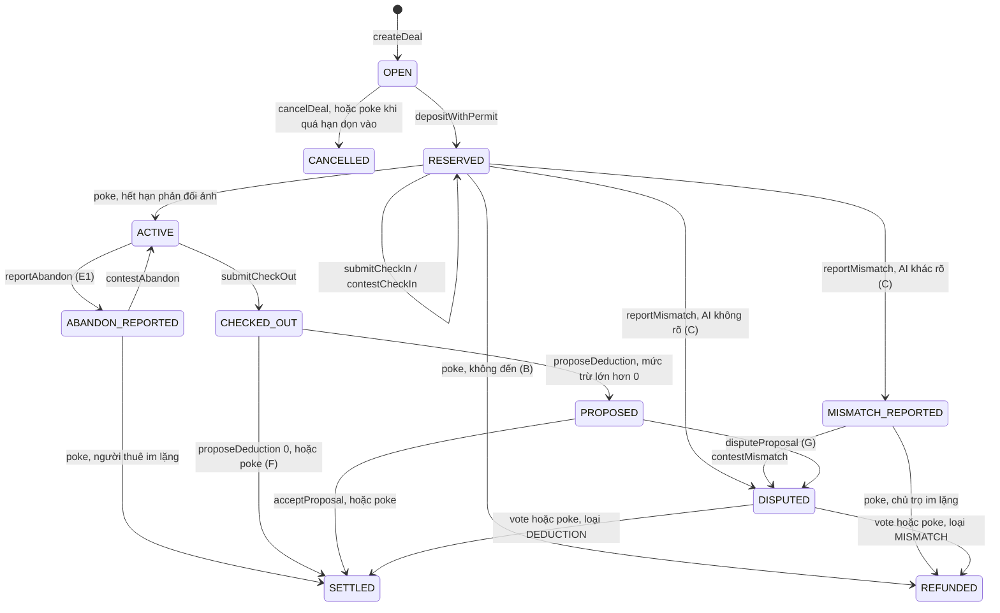

# Luồng người dùng – Két Cọc Trọ

Tóm tắt doc "User flow chi tiết" bản chốt 12/11 và ánh xạ từng bước sang màn hình, API và hàm contract. Phần "Bản cũ 08/11" trong doc (hai loại cọc, QR check-in, CHECKED_IN/AGREED/EXPIRED) đã bỏ, đừng dùng.

File này không chép lại công thức chia tiền, hạn chót hay schema JSON. Những phần đó nằm ở `contract-spec.md`, `api-contract.md`, `data-contract.md`; nếu file này lệch với chúng thì 3 file kia đúng.

## Nguyên tắc

- Tạo hợp đồng = đăng phòng. Ai gửi cọc trước người đó thuê.
- Người dùng làm ít thao tác nhất. Bên nào im lặng tới hạn thì bên đó chịu; bot keeper gọi `poke`, nút "Xử lý quá hạn" là đường dự phòng khi bot ngừng.
- Luồng chuẩn 7 bước: Đăng phòng → Gửi cọc → Nhận phòng → Đang ở → Trả phòng → Đề xuất mức trừ → Chia tiền.
- Người thuê ký 3 lần (gửi cọc, ảnh nhận phòng, ảnh trả phòng). Chủ trọ ký 2 lần (đăng phòng, đề xuất). Ảnh nhận phòng được chấp nhận khi chủ trọ im lặng.
- Chỉ trừ hư hỏng. Không trừ nợ tiền phòng, điện nước. Chủ trọ đề xuất một con số tổng (duyệt từng dòng là tầm nhìn).
- Khi demo, mọi hạn chót tính bằng phút (cột Demo trong `contract-spec.md`).

## Sơ đồ trạng thái

Thay cho ảnh bản đồ cũ trong doc.

## Các nhánh

Ký hiệu nhánh dùng chung với doc User flow.

| Nhánh | Tình huống | Hàm contract | Outcome khi chia tiền | Mức |
| --- | --- | --- | --- | --- |
| A | Chủ trọ gỡ tin khi chưa ai cọc | `cancelDeal` | Không có tiền | P0 |
| B | Người thuê không gửi ảnh nhận phòng tới hạn | `poke` | `NO_SHOW` | P0 |
| C | Phòng không đúng mô tả | `reportMismatch`, `contestMismatch`, `vote` | `MISMATCH` hoặc `NO_SHOW` | P1 |
| D | Chủ trọ phản đối ảnh nhận phòng (1 lần) | `contestCheckIn` | Người thuê chụp lại | P2 |
| E1 | Người thuê bỏ ngang | `reportAbandon`, `contestAbandon`, `poke` | `ABANDONED` | P1 |
| E2 | Hết hạn thuê mà người thuê không trả phòng | `submitCheckOut` do chủ trọ gọi | Đi tiếp GĐ6 | P1 |
| F | Chủ trọ không đề xuất tới hạn | `poke` | `LANDLORD_SILENT` | P0 |
| G | Người thuê kháng nghị | `disputeProposal`, `vote`, `poke` | `NORMAL` với con số thắng | P1 |
| H | Server AI sập | `proposeDeduction` với `aiSig` rỗng | Như thường, không có phiếu AI | P0 |

## Từng giai đoạn

### GĐ0 · Onboarding

| # | Ai | Thao tác | API | Contract |
| --- | --- | --- | --- | --- |
| 1 | Cả hai | Đăng nhập Google hoặc ví (Privy), chọn vai trò | `GET /config` | — |
| 2 | Cả hai | "Nhận tiền test" | `POST /faucet` | — |

Edge case: sai mạng → banner + nút chuyển Fuji; hết gas → hướng dẫn faucet, demo dùng ví nạp sẵn; chủ trọ tự cọc phòng mình → `LandlordCannotRent`; mất ví → khôi phục qua tài khoản Google (Privy).

### GĐ1 · Chủ trọ đăng phòng

Mọi con số tiền, ngày, vị trí chụp và bảng giá nhập ở đây và bị khóa bằng `termsHash`.

| # | Thao tác | Lưu ở | API / Contract |
| --- | --- | --- | --- |
| 1 | Thông tin phòng: địa chỉ, ảnh, giá thuê, dịch vụ kèm theo | Ngoài chuỗi, ảnh hash vào `termsHash` | `POST /uploads` (`purpose=listing`) |
| 2 | Tiền cọc, phí giữ chỗ | Trên chuỗi | trong `POST /listings` |
| 3 | Ngày dọn vào, ngày hết hạn thuê | Trên chuỗi | trong `POST /listings` |
| 4 | Vị trí cần chụp (3–10), mỗi vị trí một ảnh ví dụ | Ngoài chuỗi, hash vào `termsHash` | `POST /uploads` (`purpose=example`) |
| 5 | Bảng giá sửa chữa | Ngoài chuỗi, hash vào `termsHash` | trong `POST /listings` |
| 6 | Bật/tắt cho cọc sinh lãi | Trên chuỗi | `yieldEnabled` |
| 7 | Bấm "Đăng" (ký) | — | `POST /listings` → `createDeal(createDealArgs)` → `POST /listings/:id/onchain` → OPEN |

Edge case: nhập sai hoặc đã cho thuê ngoài, chưa ai cọc → nhánh A; sửa ảnh, giá sau khi có người cọc → không được, đã khóa bằng hash; một phòng đăng nhiều lần → tầm nhìn (mã phòng duy nhất).

### GĐ2 · Tìm phòng và gửi cọc

| # | Ai | Thao tác | API / Contract |
| --- | --- | --- | --- |
| 1 | Người thuê | Xem "Phòng đang trống", ảnh, điều khoản, bảng giá | `GET /listings?state=OPEN`, `GET /deals/:id` |
| 2 | Người thuê | Tích (hoặc không) "Cho cọc sinh lãi", bấm "Gửi cọc" (ký 1 lần) | `depositWithPermit(id, wantYield, ...)` → RESERVED |
| 3 | Chủ trọ | Nhận thông báo | Xem mục "Chưa có trong spec" |
| 4 | Hệ thống | Phòng tự ẩn khỏi danh sách | `GET /listings?state=OPEN` không trả deal này nữa |

Edge case: hai người cọc cùng lúc → giao dịch sau revert, không mất tiền; người khác cọc trước người đã hẹn → đúng luật; giữ phòng rồi không đến → nhánh B.

### GĐ3 · Nhận phòng

Ảnh nhận phòng là bằng chứng gốc. Chỉ chụp bằng camera trong app, có thời gian và GPS nếu lấy được.

| # | Ai | Thao tác | API / Contract |
| --- | --- | --- | --- |
| 1 | Người thuê | Ngày dọn vào: chụp từng vị trí, có ảnh ví dụ hướng dẫn góc | `POST /uploads` (`purpose=checkin`) cho từng vị trí |
| 2 | Người thuê | "Gửi ảnh nhận phòng" (ký) | `POST /deals/:id/photo-sets` (`kind=checkin`) → `submitCheckIn(id, setHash)` |
| 3 | Chủ trọ | Có `checkInObjection` để phản đối; im lặng là đồng ý | `poke` → ACTIVE |

Nhánh C (người thuê bấm "Phòng không đúng mô tả", trước khi gửi ảnh nhận phòng): chụp thực tế (`purpose=mismatch`, `kind=mismatch`) → `POST /deals/:id/ai/mismatch` → `reportMismatch(id, verdict, evidenceHash, reportHash, aiSig)`.

| AI kết luận | Xử lý |
| --- | --- |
| Khác rõ (2) | MISMATCH_REPORTED; chủ trọ có `mismatchWindow` để phản đối. Im lặng → hoàn đủ cọc. Phản đối → bồi thẩm, phiếu AI cho người thuê |
| Không rõ (1) hoặc không có con dấu | Bồi thẩm ngay, không có phiếu AI |
| Giống (0) | Contract revert `BadVerdict`. Xem mục "Chỗ lệch" số 1 |

Edge case: quá hạn dọn vào chưa gửi ảnh → nhánh B, REFUNDED; chủ trọ phản đối ảnh → nhánh D (P2); chủ trọ cho người khác thuê sau khi nhận cọc → nhánh C; đổi ngày dọn vào → tầm nhìn.

### GĐ4 · Đang thuê

Cọc nằm trong contract hoặc vault, không ai rút được. App hiện ngày hết hạn và lãi tạm tính (khi có vault).

| Tình huống | Xử lý |
| --- | --- |
| Người thuê bỏ ngang (E1) | Chủ trọ bấm "Báo người thuê bỏ đi" → `reportAbandon`. Người thuê bấm "Tôi vẫn đang ở" → `contestAbandon`, quay lại ACTIVE, không qua bồi thẩm. Im lặng tới hạn → `poke`, chủ trọ nhận cọc |
| Dọn đi sớm có báo | Gửi ảnh trả phòng bất cứ lúc nào, sang GĐ5 |
| Gia hạn, sửa sang phòng giữa chừng | Tầm nhìn |
| Nợ tiền phòng, điện nước | Ngoài MVP |

### GĐ5 · Trả phòng và AI

| # | Ai | Thao tác | API / Contract |
| --- | --- | --- | --- |
| 1 | Người thuê | Chụp lại đúng các vị trí, ảnh nhận phòng mờ đè lên khung (lớp mờ: P2) | `POST /uploads` (`purpose=checkout`) |
| 2 | Người thuê | "Gửi ảnh trả phòng" (ký) | `POST /deals/:id/photo-sets` (`kind=checkout`) → `submitCheckOut(id, setHash)` → CHECKED_OUT, vault trả gốc + lãi về contract |
| 3 | App | Ngay khi giao dịch xác nhận, gọi AI | `POST /deals/:id/ai/damage`, rồi hỏi `GET` tới khi `done` hoặc `failed` |
| 4 | AI + API | So từng vị trí: `NEW_DAMAGE`, `WEAR`, `NO_CHANGE`, `UNCLEAR`. API nhân đơn giá; hư hỏng ngoài bảng giá gắn nhãn, không cộng vào mức AI ký | Con dấu `DamageReport` |

Cả hai bên cùng thấy kết quả (`GET /deals/:id/ai/damage` công khai). Edge case: người thuê không trả phòng sau `leaseEnd + checkOutGrace` → nhánh E2, chủ trọ tự chụp và gọi `submitCheckOut`; thiệt hại lớn hơn cọc → `sealedAmount` tối đa bằng cọc; AI sập → nhánh H.

### GĐ6 · Đề xuất, phản hồi, bồi thẩm, chia tiền

| # | Ai | Thao tác | API / Contract |
| --- | --- | --- | --- |
| 1 | Chủ trọ | Xem báo cáo, mức trừ điền sẵn bằng `aiAmount` (0 = hoàn đủ), bấm "Đề xuất" (ký) | `proposeDeduction(id, amount, seal.aiAmount, seal.reportHash, seal.signature)` |
| 2 | Người thuê | Đồng ý: không làm gì, hoặc bấm "Đồng ý" để nhận ngay | `acceptProposal` |
| 3 | Bot | Hết `respondWindow` → chia theo mức chủ trọ đề xuất | `poke` → SETTLED |

Nhánh G: người thuê bấm "Kháng nghị", nhập con số của mình (nhỏ hơn đề xuất) → `disputeProposal(id, counterAmount)`. Bồi thẩm xem bằng chứng (`GET /disputes?juror=`, `GET /disputes/:id`, chỉ các vị trí bị tranh chấp) và chọn một bên bằng `vote(id, side)`. Phiếu AI về con số gần `aiAmount` hơn. Hết hạn mà chưa bên nào đủ 2 phiếu: theo quy tắc ở mục Tranh chấp trong `contract-spec.md`.

## Danh sách màn hình

Cột Mức theo `AGENTS.md` (P0/P1/P2); doc User flow ghi MUST/SHOULD.

| Màn hình | Vai trò | GĐ | Nội dung chính | Mức |
| --- | --- | --- | --- | --- |
| Đăng nhập, chọn vai trò | Cả hai | 0 | Google hoặc ví, mạng Fuji, nút nhận tiền test | P0 |
| Phòng đang trống | Người thuê | 2 | Danh sách deal OPEN | P0 |
| Đăng phòng + hợp đồng (nhiều bước) | Chủ trọ | 1 | Thông tin phòng, cọc, phí giữ chỗ, ngày, vị trí chụp kèm ảnh ví dụ, bảng giá, bật sinh lãi | P0 |
| Chi tiết phòng + Gửi cọc | Người thuê | 2 | Ảnh, điều khoản, bảng giá, ô "Cho cọc sinh lãi", nút Gửi cọc | P0 |
| Chi tiết hợp đồng | Cả hai | 1–6 | Trạng thái, đếm ngược `deadline`, nút theo bảng "Nút trên app theo trạng thái", nút "Xử lý quá hạn" khi `canPoke` | P0 |
| Camera chụp theo vị trí | Người thuê (chủ trọ khi trả thay) | 3, 5 | Từng vị trí một, ảnh ví dụ, ảnh cũ mờ đè khung | P0 (lớp mờ: P2) |
| Báo phòng không đúng | Người thuê | 3 | Chụp thực tế, kết quả AI so với ảnh đăng tin | P1 |
| Kết quả AI + Đề xuất mức trừ | Chủ trọ | 6 | Báo cáo AI, mức trừ điền sẵn, nút Đề xuất | P0 |
| Phản hồi / Kháng nghị | Người thuê | 6 | Báo cáo, mức trừ, nút Đồng ý và Kháng nghị | P0 (Kháng nghị: P1) |
| Biên nhận cuối | Cả hai | 6 | Ai nhận bao nhiêu (event `Paid`), link Snowtrace | P0 (link Snowtrace: P1) |
| Đang thuê | Cả hai | 4 | Ngày hết hạn, lãi tạm tính, nút Báo người thuê bỏ đi | P1 |
| Bỏ phiếu | Bồi thẩm | 3, 6 | Ảnh vị trí tranh chấp, báo cáo AI, nút bỏ phiếu | P1 |

## Chưa có trong spec

Làm phương án đơn giản nhất ghi ở cột phải; ai đổi thì sửa spec trước.

| # | Doc User flow cần | Phương án tạm |
| --- | --- | --- |
| 1 | Chủ trọ "nhận thông báo" khi có người cọc (GĐ2 bước 3) | Không push. Màn "Hợp đồng của tôi" gọi `GET /deals?wallet=` khi mở và hiện trạng thái mới |
| 2 | "Chọn vai trò" lúc onboarding | Chỉ là lựa chọn giao diện, không lưu. Quyền thật theo địa chỉ ví `landlord` / `tenant` trong deal |
| 3 | Kết quả AI phòng sai mô tả | `api-contract.md` chỉ có `POST /deals/:id/ai/mismatch`, chưa có `GET` để hỏi lại như AI hư hỏng. Cần Khải chốt: chạy đồng bộ hay gửi việc rồi hỏi |
| 4 | "Lãi tạm tính" ở GĐ4 | Chưa có trường. Khi có vault (P2): `vault.convertToAssets(vaultShares) - deposit`, trước phí sàn |
| 5 | "Phòng tự ẩn khỏi danh sách" | `GET /listings?state=OPEN` phải lọc bằng trạng thái đọc từ contract, không lưu cột trạng thái |

## Chỗ lệch giữa doc User flow và spec (nhóm cần chốt)

| # | Doc User flow nói | Spec đang ghi | Đề xuất |
| --- | --- | --- | --- |
| 1 | Nhánh C, AI kết luận "Giống" → coi như người thuê đổi ý → nhánh B | `reportMismatch` với verdict 0 revert `BadVerdict`; deal vẫn RESERVED, người thuê không gửi ảnh nhận phòng thì tới hạn `poke` ra `NO_SHOW` | Giữ spec: tiền về y như nhánh B, chỉ chậm tới hết `moveInGrace`, và người thuê vẫn nhận phòng được. Sửa câu chữ trong doc |
| 2 | Hạn dọn vào = "ngày dọn vào + 1 ngày (chủ trọ nhập)" | `moveInGrace` cố định trong constructor, chủ trọ chỉ nhập `moveInDate` | Giữ spec. Doc ghi rõ chủ trọ chỉ nhập ngày dọn vào |
| 3 | Màn Bỏ phiếu dùng ở GĐ 3, 4, 6 | Nhánh E1 (GĐ4) không qua bồi thẩm, cả trong doc lẫn spec | Bỏ GĐ4 khỏi màn Bỏ phiếu |
| 4 | MUST: "Báo phòng không đúng", link Snowtrace ở biên nhận; GPS coi như có sẵn | `AGENTS.md`: phòng sai mô tả và biên nhận Snowtrace là P1, GPS là P2 | Theo `AGENTS.md` (đã ghi ở cột Mức phía trên) |
